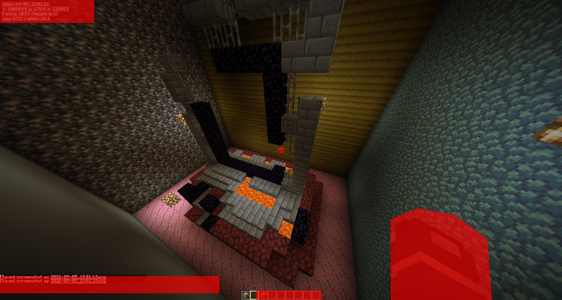
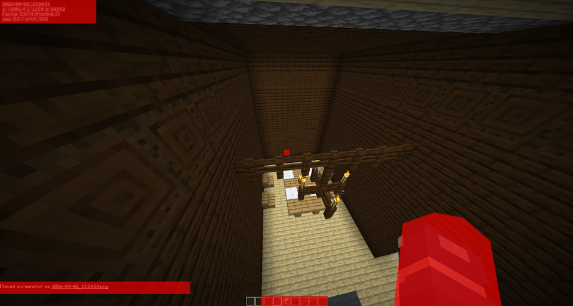
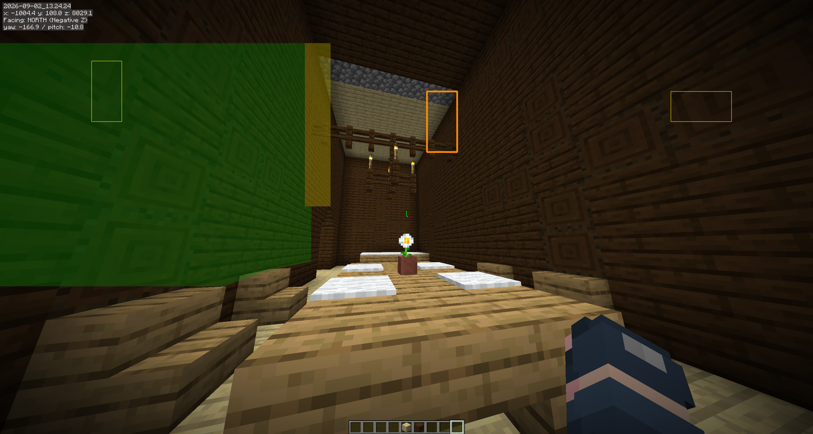
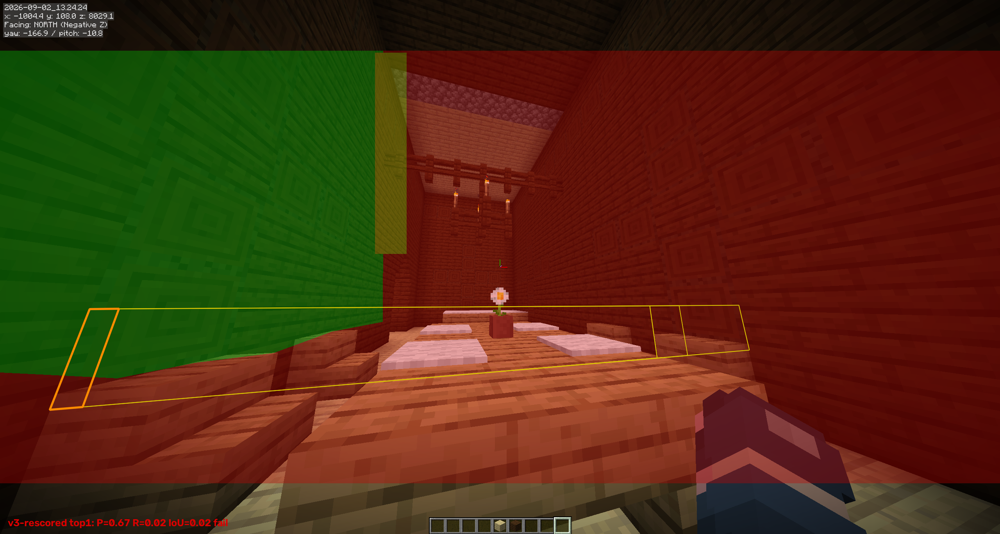

# Project handoff: Minecraft screenshot reconstruction (postmortem)

**Status:** User-declared failure / development ended, 2026-10-11 (America/Chicago). This file is the active handoff for any postmortem or blog-writing work. Product development is not authorized by this handoff.

**Audience:** Project owner first; a future agent should also be able to produce an accurate, technically grounded retrospective without reopening the entire experiment archive.

## 1. Executive summary

The project set out to turn ordinary Minecraft screenshots or footage into a useful `.litematic` containing the visible build. It accumulated substantial code, tests, diagnostics, calibration and reconstruction experiments, export support, and dataset tooling. It did not deliver the promised default-mode product: image-derived cameras and scene extent feeding a trustworthy block reconstruction and `.litematic` that passed the agreed quality gates.

The failure is an outcome judgment, not a claim that screenshot reconstruction is impossible. By the user's decision, effort is stopping because the work consumed a very large amount of time without a convincing functional result. The latest locally recorded hours are unresolved; do not state an exact total. A previous estimate of about 235.8 hours was stale and not independently refreshed.

The clearest final evidence is negative end-to-end evidence. The October 11 AB-04/AB-05 image-derived camera/matcher experiment produced zero correct accepted camera edges across six views; one false pair was accepted in each detector arm and all frames remained disconnected. No geometry score, visible-state score, or image-only `.litematic` resulted. Separate image-only plane proposals returned very little useful coverage and failed their preregistered continuation criteria. Later pipeline diagnostics repeatedly stopped before evaluating physical geometry. None of these experiments proves the task is impossible; they show the implementation and evidence available at project close did not establish a path to product quality.

The most important process lesson: passing unit tests, synthetic controls, adapter reviews, and safety gates did not measure whether ordinary images could be reconstructed. We did not make a small frozen end-to-end benchmark with reliable truth, ordinary inputs, and a produced artifact the governing progress measure early enough. The project repeatedly improved instrumentation and local contracts while the user's core success metric stayed unproven.

## 2. Product goal and binding scope

### Intended product

- Input: ordinary vanilla Minecraft screenshots or video; eventually shaders and arbitrary resource packs.
- Output: a reviewable `.litematic` with visible blocks, useful material/state guesses, uncertainty, and a distinction between observed and inferred blocks.
- Buildings and rooms were the first product target; irregular terrain/geodes were later scope.
- The normal workflow must infer camera, scale when identifiable, relative placement, and bounds from pixels. A user should not need to supply world coordinates, camera poses, F3 text, directions, manifests, reference bounds, or a known length.
- Camera manifests, F3/debug data, directions, coordinates, bounds, and known lengths may be used for developer experiments, refinement, or evaluation only. If exposed in the product, they belong behind explicit advanced/developer options and must be labelled assisted.
- Vanilla texture recognition was the proof of concept. Long-term scope included matching unknown resource packs to vanilla or accepting a supplied pack/JAR.
- The desired gates were **90% visible geometry F1** and **80% exact visible-state recovery** on Template 2, Template 6, and a frozen small-view Template 3 subset. These were intended product gates, not achieved scores.
- Target performance was image-only Template 2 in at most three minutes on the development machine after warm-up. This was provisional and never established as a quality tradeoff.

### Fair interpretation of screenshots

Minecraft scenes contain repeated textures, view-dependent occlusion, non-Lambertian lighting/shaders, GUI overlays, and blocks with identical appearance but different hidden state. A screenshot can be geometrically ambiguous; absolute scale is not always observable without identifiable block/texture spacing or an explicit constraint. The intended product therefore needed to preserve ambiguity and request optional review where the pixels cannot determine a unique scene. It was not acceptable to quietly consume debug coordinates as normal input or fabricate hidden volumes.

## 3. What exists, and what does not

### Implemented foundations (not equivalent to a working product)

- Python application, CLI, desktop UI, project/session persistence, image/video ingress, evaluation scripts, and extensive unit/integration tests.
- Camera calibration, Manhattan/lattice estimation, local supported-plane and block proposals, candidate matching, texture/state scoring, uncertainty/provenance structures, and reconstruction orchestration have all had implementation work.
- Exporters for `.litematic` and Anvil/world ZIP exist. Export itself was not the central missing capability. The production image-derived path lacked a qualified reconstruction to export.
- A dataset/template factory and a collection of Minecraft capture fixtures/ground-truth assets exist in the repository. Those assets were useful for experiments but did not become a sufficiently small, stable, independently scored product gate.
- GPU acceleration groundwork and separate environments were explored. No validated AMD GPU end-to-end speedup or product-critical accelerated renderer was established. Do not imply GPU dependencies are universally installed or production wired.
- Tests often passed for contracts, individual geometry functions, data provenance, refusal behaviour, and synthetic controls. This demonstrates that particular code paths behaved as tested; it is not a proxy for visible block/state accuracy.

### Not demonstrated at project close

- No qualifying ordinary-image run met the production geometry/state gates.
- No independently scored image-only reconstruction produced a deliverable `.litematic` with measured visible accuracy.
- No robust, generally usable multi-view camera recovery and connectivity on the frozen six-image ordinary screenshot fixture.
- No measured exact-state accuracy percentage on that image-only fixture. Do not convert assisted block counts into a current product percentage.
- No evidence that any learned or reinforcement-learning recognizer improved end-to-end quality. Model/RL integration remained an idea, not a validated outcome.
- No validated arbitrary-resource-pack/shader support.
- The latest project progress record reports 0 percentage-point gain in image-only geometry/state/export; this is a status accounting claim, not proof that every local component had zero improvement.

### Theoretical-maximum match reporting

Historical counts exist, but they are not the requested image-only theoretical-maximum score. Example values in `PROJECT_PROGRESS_STATE.json` are diagnostic and assisted:

| Fixture/run | Correct exact blocks | Visible denominator | Interpretation |
|---|---:|---:|---|
| Template 2 assisted | 480 | 667 | Supplied-camera/reference-assisted; not production image-only |
| Template 6 default diagnostic | 350 | 2,007 | Supplied-camera; not production image-only |
| Template 6 no-prune ablation | 511 | 2,007 | Diagnostic ablation, acceptance-ineligible |

Candidate ceilings (561, 393, 788 respectively) are separate diagnostics; they are not theoretical maximum percentages or product accuracy. For a blog, report counts with their denominator and assistance basis. If mentioning percentages, calculate them explicitly and label them assisted/diagnostic; never call them end-to-end image-only performance. No reliable comparable image-only “% of theoretical max” was established.

## 4. Evidence at project close

### Final six-image camera/matcher experiment

AB-04 and AB-05 used one development fixture with six images and 15 pair opportunities per detector arm. AB-04 exposed a severe image-0003 camera failure: pitch error about -102.6 degrees and rotation error about 102.7 degrees; focal error about +47%. The other five cameras had much smaller reported rotation error (0.29–2.78 degrees). The only accepted image pair was false by about 101.8 degrees. AB-05 applied a fixed-anchor calibration correction but image-0003 remained wrong and focal error worsened to about +134%; the same false pair persisted. Each arm ended with zero correct accepted edges and six disconnected frame components. These are camera/matcher metrics, not block reconstruction scores.

Source reports:

- `docs/reports/spatial-sift-matcher-ab-04-2026-10-11/pair-ab.scalar.json`
- `docs/reports/spatial-sift-matcher-ab-05-2026-10-11/pair-ab.scalar.json`

These are one-shot, development-scene experiments, not broad holdout generalization. No geometry F1, exact-state result, or export was produced. AB-04/05 artifacts are diagnostics and must not be described as promoted production changes.

### Image-only production graph/geometry diagnostics

The latest inspected G7 selector diagnostic (`docs/failure-postmortem/evidence/g7-seed-predicate-01.selection-diagnostic.json`) reports 18 accepted readings, 4,086 candidates, 81 signatures, and no eligible assignment. The bounded search visited 1,024 assignments; all first failed at `axis_0_disconnected`. It recorded 251,659 relation visits, zero eligible assignments, zero physical assignments, and zero geometry evaluations. Production status was `geometry_unavailable` / `g_unavailable`; no block count or delivery digest exists.

This pinpoints where that run stopped; it does not establish why the underlying pixels lack evidence, prove a missed visible wall, or identify a single repair. Earlier partial-search runs have different counts and should not be mixed into this latest result. Refer to the exact report before quoting values.

### Proposal experiments

An image-only plane/region proposal evaluation on three Template 2 frames failed its preregistered continuation criteria. It did not achieve a candidate with at least 0.50 individual recall on all three frames. The top proposal on the pictured middle frame had reported precision, recall, and IoU of 0.02 each in a separate v3 rescoring artifact (different experiment/version; preserve the version distinction). Proposal masks were not unioned across planes. These diagnostics demonstrate poor proposal coverage on those fixtures, not a complete evaluation of all possible geometry methods.

Sources:

- `docs/reports/M4-C3-image-plane-proposals-2026-09-12/evaluation.json`
- `docs/reports/M4-C2-rescored-v3-2026-09-09/results.json`
- `docs/reports/M4-F3-annotation-audit-2026-09-09/`

### Camera evaluation that never ran

The final camera-evaluator packet was reviewed for disabled readiness and source closure, but its authorization flags remained false and it was not run. It yielded no camera score and no reconstruction evidence. Several earlier camera and cross-view one-shot packets were spent on failures or refusals. A task packet being reviewed, sealed, or tested offline must never be presented as a completed experiment.

### Testing claims

The codebase accumulated a large test suite and many focused test runs. Counts vary by date and subset; the active handoff at the time of close explicitly said no current full-suite result was claimed and referenced an old historical 252-test snapshot. Do not repeat a blanket “238 passing tests” or “all tests pass” without finding a dated log, exact revision/source state, command, and scope. Even a fully passing test suite would not alter the product failure conclusion without an image-only scored result.

## 5. Why the project failed (evidence versus diagnosis)

### Direct causes supported by artifacts

1. **The key end-to-end gate stayed unmet.** The default image-only route did not produce a scoreable geometry/state result and `.litematic` on the fixtures needed for promotion.
2. **Camera recovery/connectivity remained unreliable.** Latest pairwise experiment accepted no correct edges; a false edge connected the wrong views, leaving all six disconnected.
3. **The geometry pipeline could not proceed from current observations.** Latest inspected G7 selector found no eligible assignment and evaluated no physical geometry. Its fail-closed behavior prevented unsupported output but also meant there was no product artifact.
4. **Local proposal quality was insufficient.** Frozen proposal reports show failed recall/precision criteria on the small evaluated set.
5. **Progress evidence did not map to user value.** There were many tests, reviews, source pins, diagnostics and bounded experiments but few comparable image-only scores, and no qualifying user-facing delivery.
6. **Experiments were frequently one-shot, narrowly scoped or blocked before the scientific question was evaluated.** Some runs failed in harness/process accounting; others stopped before candidate freeze, before physical geometry, or before evaluator authorization. A refusal or harness failure is not a negative algorithm result, but it still consumed time without advancing the product.

### Likely contributing process/architecture causes (analysis, not experimentally isolated root causes)

- The architecture accumulated sequential gates and bespoke metadata/observers. This made failures safe and traceable, but often meant experiments measured a precondition rather than reconstruction quality.
- The work split into many narrow milestone tasks and repeated reviews. Local correctness and acceptance artifacts were optimized more consistently than a thin vertical slice from ordinary pixels to a visually inspectable, scored `.litematic`.
- Ground truth, camera truth, valid pixel masks, and alignment rules were complex and changed across experiments. Multiple assisted metrics were easy to mistake for user-facing progress unless their basis was carefully tracked.
- Feature matching is poorly conditioned on repetitive Minecraft textures, low texture variation, occlusion, and limited viewpoint overlap. The latest results are consistent with this being a central technical bottleneck but do not isolate it as the only root cause.
- Camera, scale, surface support, block proposals, materials, and exact states were pursued as a broad system before a narrow scene class was made reliably successful. This raised integration risk.
- Requirements expanded to shaders, arbitrary resource packs, footage, dataset generation, GPU acceleration, RL, and user-facing UI while the vanilla image-only proof of concept remained unvalidated. Those ambitions were legitimate long-term scope but diluted focus.
- A reported “98% human” expectation was never translated into a clearly defined, frozen metric and a like-for-like benchmark. Human visual plausibility and exact block/state accuracy are different measures.

### What is not proved

- The evidence does not prove image-to-Minecraft reconstruction is infeasible, nor that a learned model or RL cannot help.
- It does not show every screenshot is sufficiently informative to recover all hidden blocks. Many are fundamentally ambiguous.
- It does not establish that the exporter, application, or all algorithm components are broken. Export and many isolated functions work; integration quality did not meet the goal.
- It does not justify describing supplied-camera or reference-assisted outputs as autonomous success.
- It does not establish a precise total-hours figure. The user cited approximately 240 hours as a stop condition; the latest authoritative tracker could not reconcile actual hours.

## 6. Visual evidence and provenance

The following are copies of authentic repository images. Their originals remain unchanged at the cited paths. They illustrate input difficulty and one concrete failure; they are not a representative statistical sample.

### Template 6: cluttered, occluded scene

Original: `docs/evaluation_masks/coverage/templates-6/2026-09-05_18.01.22.png`. Minecraft capture with HUD/debug capture annotations; useful context for clutter and occlusion. Debug text is evaluation/developer evidence only and must not be treated as a permitted normal-mode input.

### Template 2: indoor structure and repeated wood textures

Original: `docs/evaluation_masks/coverage/templates-2/2026-09-02_13.24.33.png`. Input capture corresponding to the evaluated room/build family. Repeated plank/log textures and occlusion make generic keypoint matching ambiguous.

### Plane-proposal output: sparse coverage

Original: `docs/reports/M4-C3-image-plane-proposals-2026-09-12/overlays/2026-09-02_13.24.24_proposals.png`. Overlay from an image-only proposal experiment. Green/red regions are algorithm proposal/annotation overlays, not an exported reconstruction. Its evaluation report is negative on preregistered continuation criteria.

### Boundary proposal failure visualization

Original: `docs/reports/M4-C2-rescored-v3-2026-09-09/overlay_v3_2026-09-02_13.24.24.png`. The report labels top-1 `P=0.67, R=0.02, IoU=0.02 fail`. This is a boundary-region proposal diagnostic, not whole-scene geometry F1 and not a final `.litematic` render.

## 7. Technical orientation for a future agent

The codebase grew into a broad staged pipeline. A useful starting map (paths may have evolved; inspect current checkout before making claims):

- `src/mc_photogrammetry/input/`: still image/video ingestion.
- `src/mc_photogrammetry/reconstruction/`: camera/lattice/shape/material estimation and evaluation functions.
- `src/mc_photogrammetry/pipeline/`: image-derived orchestration, correspondence, camera graph, geometry selection, delivery policies.
- `src/mc_photogrammetry/export/litematic.py`: `.litematic` serialization; exporter existence does not mean image-derived output is qualified.
- `src/mc_photogrammetry/export/anvil.py`: world export.
- `src/mc_photogrammetry/ui/` and `cli.py`: user-facing entry points.
- `tests/`: unit, contract, synthetic, and integration tests; classify each by what it actually validates.
- `docs/reports/`: dated experiment artifacts, often one-off. Read report methodology and status before using its numbers.
- `exports/diagnostics/`: latest failure reports, including seed-predicate G7.
- `PROJECT_PROGRESS_STATE.json`: latest structured project snapshot available at close; historical/dated, not live telemetry.
- `AGENT_COMMS.md`: very large append-only multi-agent log, with invalid UTF-8 bytes near EOF. **Do not decode/rewrite the full file.** Append ASCII-only entries byte-safely if needed.

Useful specific source locations from the final audit:

- `pipeline/image_derived_production_delivery.py`: production entry to delivery.
- `pipeline/image_derived_production.py`: production controls, geometry, promotion, output flow.
- `pipeline/image_derived_geometry_orchestration.py`: stage runner and stop-status mapping.
- `pipeline/image_derived_joint_graph.py`: endpoint hypothesis selection and graph status.
- `reconstruction/endpoint_hypothesis.py`: per-axis connectivity refusal (`axis_<n>_disconnected`).
- `pipeline/joint_matching.py`: candidate correspondence, spatial-spread and cheirality rejection.

These are navigation pointers from a final audit, not a guarantee that line numbers or files remain unchanged. No need to resume product work for the requested blog post.

## 8. Blog-post handoff

### Suggested angle

Write a candid engineering postmortem about the gap between “the code and tests are busy” and “the product works on ordinary inputs.” The most defensible story is an ambitious computer-vision pipeline that built sophisticated gates and diagnostics but failed to convert them into measurable image-only reconstruction quality before the user ended the project.

### Suggested narrative

1. State the product promise and what users would have supplied.
2. Show real input screenshots and explain ambiguity, repetitive textures, occlusion and hidden state.
3. Briefly describe the pipeline layers: camera/calibration, correspondences, supported geometry, block/state recognition, review, export.
4. Contrast accumulated engineering output with the missing end-to-end result. Explain why unit tests and assisted exports did not satisfy the goal.
5. Present exact negative evidence with date, fixture scope, metric, and provenance: AB-04/05 camera graph; G7 selector stop; proposal failure; no image-only score/export.
6. Explain the process diagnosis as interpretation, not proven causal science.
7. Close with lessons and what a future restart would do differently: freeze a small natural-image benchmark first, use one ordinary-image vertical slice, score artifact quality every experiment, prioritize camera connectivity/scale observability, minimize gates that do not affect product quality, keep assisted tooling clearly separate, and set an early kill criterion.

### Fact-check and language rules

- Prefer “failed to meet the project's gates” over “impossible.”
- Distinguish direct evidence, interpretation, and future speculation.
- Date and scope every numeric result; do not merge AB-04 with AB-05 or mix proposal-v3 with proposal-v4.
- Say “zero correct accepted edges, one false accepted pair per arm, six disconnected frames” rather than “0% accuracy” (there is no such overall metric here).
- Say “no qualifying image-only `.litematic`/score at close,” not “the repository cannot export litematics.”
- Label 480/667 and 350/2,007 as supplied-camera/assisted diagnostic counts. Do not present them as autonomous output or theoretical-maximum percentages.
- Do not say “238 tests passed” unless the exact dated run, command, revision, and scope are located. Tests are not product accuracy.
- Do not state exact hours. Latest authoritative counter was unreconciled; “roughly 240 hours were cited by the owner” is permissible only as an attributed, approximate statement.
- Do not imply RL, DeepSeek, other model calls, or GPU acceleration were part of a successful solution; no validated end-to-end gain is evidenced.
- Preserve privacy and licensing constraints for screenshots/maps. The included Minecraft screenshots are from project evaluation assets; cite their original paths and avoid implying they are general dataset releases.

## 9. Source-of-truth and archive policy

- The former 43 KB active handoff is preserved as `docs/archive/AGENT_HANDOFF-pre-failure-2026-10-11.md`. It is historical and contains live-development instructions that are no longer active.
- The four curated images are under `docs/failure-postmortem/screenshots/`; provenance is recorded above.
- Key verified status snapshot: `PROJECT_PROGRESS_STATE.json` dated 2026-10-11 07:21 local. Reports are more authoritative for experiment-specific details.
- AB-04/AB-05 result provenance: `docs/reports/spatial-sift-matcher-ab-04-2026-10-11/` and `...ab-05...`.
- Selector provenance: `docs/failure-postmortem/evidence/g7-seed-predicate-01.selection-diagnostic.json` (the local run directory was under ignored `exports/diagnostics/`).
- Proposal provenance: `docs/reports/M4-C2-rescored-v3-2026-09-09/` and `docs/reports/M4-C3-image-plane-proposals-2026-09-12/`.
- Keep this active file short enough to orient a new agent. Add new postmortem writing sources as linked reports; do not restart a chronological dump.
