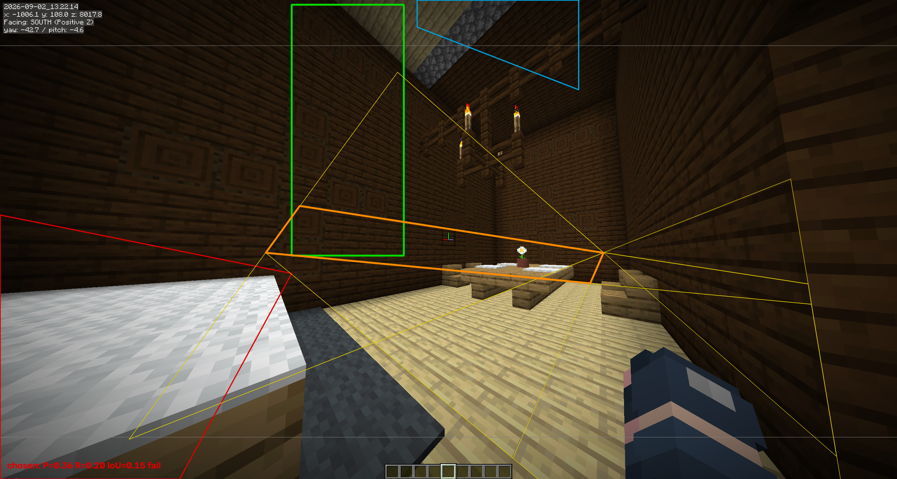

# M4 C: automatic structural-boundary proposal, one configuration, three T2 frames

**Claude Sonnet 5, 2026-09-09.** The bounded 2D-boundary experiment authorized in
[`LEAD-review-2026-09-09.md`](LEAD-review-2026-09-09.md)'s conditional next step, run
directly after the G1/G2/G3 corrections
([`M4-G1-G2-G3-fixes-2026-09-09.md`](M4-G1-G2-G3-fixes-2026-09-09.md)), per the lead's
explicit pre-authorization. One automatic proposal configuration, run once, on all
three Template 2 frames, exactly as scoped. **The local continuation condition was
not met: 0 of 3 frames reached ≥90% precision / ≥50% recall.** Reported here in full,
per the instruction to stop after these three runs and report the outcome either way.

## What ran

`src/mc_photogrammetry/reconstruction/boundary_candidates.py` (new module, 4 new
regression tests in `test_boundary_candidates.py`) reuses `calibration.py`'s
already-existing machinery unchanged: `detect_segments`/`structural_weights` for
line evidence, `vanishing_points`/`segment_residuals` for the three calibrated
lattice directions. It adds one new step, `find_chains`, which groups a frame's
calibration-inlier segments into `Chain`s - contiguous stretches of the same
physical edge, separated from other segments sharing the same *direction* by
their distinct offset along that direction's pencil of lines through the
vanishing point (or, for a direction parallel to the image plane, their
perpendicular offset). `propose_boundary_candidates` then classifies each chain
as a left/right or top/bottom edge candidate by its own projected orientation in
that image (nearly vertical vs. nearly horizontal), and combines the strongest
compatible edges into up to 8 ranked quadrilaterals - ranked purely by their own
supporting chain strength, never by comparison to any target. Where no chain
supports a side at all, the image's own frame edge fills it, recorded as an
honest fallback rather than a detection.

Camera calibration came from the existing, already-frozen, image-derived
artifact `docs/reports/M3-calibration-templates-2.json` (yaw/pitch/focal from
Manhattan-world vanishing-point search over detected segments - never a
manifest) - reused rather than rerun, per "no generic SfM rerun." Capped at 12
chains and 8 boundary candidates, no seam/period occupancy gate, no threshold
sweep, no material read anywhere in the proposal path.

`scripts/boundary_pilot.py` runs this on the three T2 source frames and scores
every candidate against a frozen per-frame target
([`M4-C-boundary-targets-2026-09-09.json`](M4-C-boundary-targets-2026-09-09.json),
hash `206ef350...53aaa84`, verified before scoring) over one fixed usable-pixel
domain (top 130px excluded for the F3 overlay, bottom 120px for the hotbar and,
on the third frame, the "Saved screenshot as..." line). The target for each frame
is a hand-drawn, deliberately conservative sub-region of the same physical wall
(the left wall's diamond-panel face), chosen to be unambiguous rather than
maximal, with foreground occlusion and the roof-gap opening recorded separately
- eyeballed on a non-zoomable static image, the same acknowledged limitation as
the M4 B real pilot's annotation. Nothing in the proposal path reads this file;
it exists only for the scoring step that runs after candidates are already
generated.

Full bundle: [`M4-C-boundary-pilot-2026-09-09/`](M4-C-boundary-pilot-2026-09-09)
(`results.json`, three overlays). Reproduce: `python scripts/boundary_pilot.py
--out-dir <dir>`.

## Result

| Frame | Chains | Candidates | Chosen P | Chosen R | Chosen IoU | Norm. boundary err | Gate |
|---|---|---|---|---|---|---|---|
| `13.22.14` | 12 | 8 | 0.360 | 0.200 | 0.148 | 0.080 | fail |
| `13.24.24` | 12 | 8 | 0.000 | 0.000 | 0.000 | 0.233 | fail |
| `13.24.33` | 12 | 8 | 0.000 | 0.000 | 0.000 | 0.286 | fail |

**0 of 3 passed; the ≥90%/≥50% local continuation condition is not met.**

This was not the best-scoring candidate among the 8 on any frame either: the
report below all 8, "including failures and competing interpretations" as
instructed, shows the *best available* candidate on frame `13.22.14` (rank 2 of
8, not the algorithm's own top pick) reached P=0.362/R=0.548/IoU=0.279 - still
well short of the gate, and still worse than the algorithm's own top-strength
pick on every other axis except recall. No candidate on any frame, chosen or
not, cleared 55% precision.

## Why: looking at the overlays

Green is the frozen target; red/blue are its declared occlusion/opening
regions; thin lines are the other 7 candidates; the thick highlighted outline
is the chosen (highest-strength) candidate. On all three frames the chosen
candidate is a thin, near-degenerate sliver, not a wall-shaped quadrilateral -
its two "vertical" edges are real chains, but not the target wall's actual
left/right boundary.

The cause is visible directly: capping chains at 12 *per whole frame*, with no
seeded region of interest (deliberately - seeding one from the target would be
exactly the leakage the review's masks-are-evaluation-only rule forbids), means
those 12 slots are won by whichever lines are longest and most contrast-heavy
anywhere in the photograph. A Minecraft interior has many strong, genuinely
structural Manhattan-aligned edges that are not a single wall's boundary: the
room's back corner, the far wall's own corner, the ceiling ridge beam, the
chandelier's hanging chains, the floor plank seams, the table and bench edges.
`structural_weights` correctly separates structural edges from in-material
texture lines, but it has no way to prefer "the boundary of one particular
plane" over "any other structural edge with a similar image-space slope" - that
distinction needs either a seeded region (ruled out here) or a further cue this
configuration was not asked to add.

## What this does and does not establish

**Does:** the mechanism - detect segments, assign to calibrated directions,
group into chains, combine into ranked candidate quadrilaterals, score against
a frozen mask over a fixed domain - runs end to end on three real photographs
with the pre-authorized caps, and the module's synthetic control
(`test_boundary_candidates.py`) shows the chain/candidate math itself is
correct: it recovers a drawn rectangle's true perspective-converging corners
to within a few pixels when the scene contains only that rectangle's own
edges. The failure is not in the geometry; it is in candidate *selection*
among many real, competing structural lines with no per-target seed.

**Does not:** meet the local continuation condition on any frame. Does not
establish that automatic 2D boundary recovery works on this fixture with this
one configuration. Per the review's explicit instruction, this report stops
here rather than adding a seam/texture cue, a threshold sweep, or a
region-of-interest seeded from the target to improve the score - any of which
would be a second configuration, not this one, and the instruction was to
report the outcome of one.

## Next

Returning this for review, as instructed, regardless of outcome.
